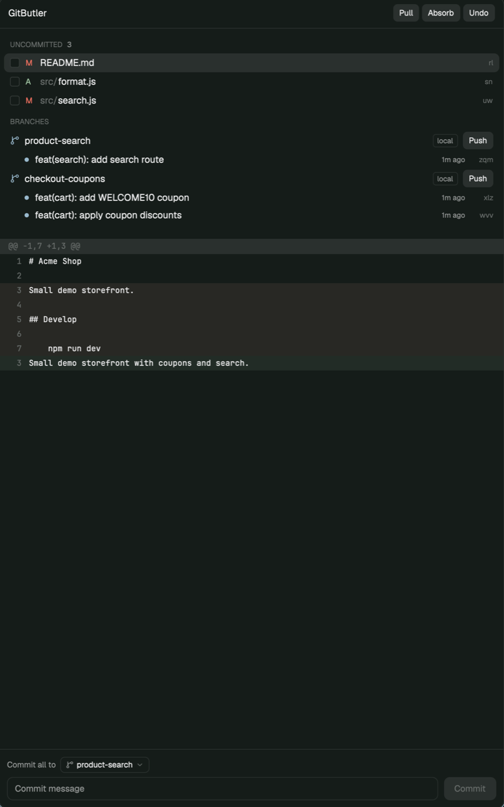

# GitButler for Herdr

A [Herdr](https://herdr.dev) side panel for the [GitButler CLI](https://docs.gitbutler.com/cli-overview) (`but`): uncommitted changes, applied branches and their commits, diffs, and one-click commit, push, pull, absorb and undo.

## Install

Ask your agent in Herdr to add `herdr.dev/mods/torchsmith/herdr-mod-gitbutler`, or copy `mods/gitbutler/` into `~/.config/herdr-app/mods/` yourself. It docks on the right the first time Herdr sees it.

Needs the `but` CLI on your PATH.

**Before installing:** this mod runs `git`, `test` and `but` in your repos (including `but push` and `but pull` when you click them). It does not reach the network itself and reads no files outside the repo.

See [RECIPE.md](RECIPE.md) for the full description.

## License

MIT
