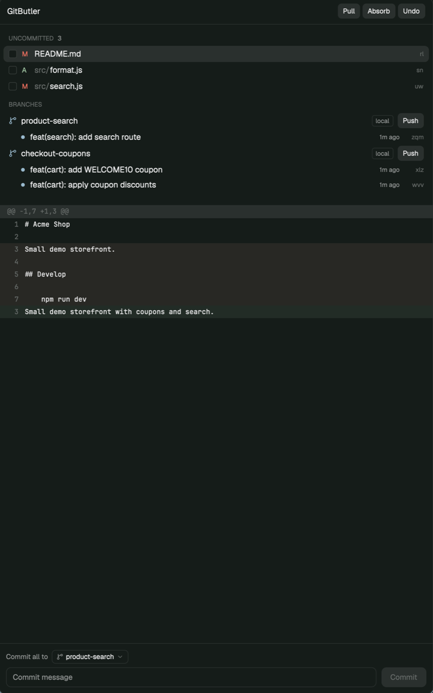

# GitButler

A side panel that puts the GitButler CLI (`but`) next to your terminals. It
lists uncommitted changes and every applied GitButler branch with its commits,
shows the diff of the file or commit you click, and commits, pushes, pulls,
absorbs and undoes with one click. It follows the focused pane's folder like
Herdr's Changes panel.

## What you see

The panel is one rounded card (radius 10, 1 px `border`, `background` fill,
13 px UI text). Top to bottom:

1. **Header**, 42 px, bottom border: "GitButler" in semibold on the left; on
   the right a spinner (`mods/workspace-chrome/spinner.svg`, 12 px, `working`
   color) while an action runs, then three 24 px buttons with 11 px text:
   **Pull** (reads `Pull ↓N` when the target branch is N commits ahead),
   **Absorb** (dim and disabled with no uncommitted changes), **Undo**.
2. **List**, as tall as its content (a scrollbar appears once it outgrows
   the space):
   - `UNCOMMITTED` section label (10 px, `dim`) with a count, or
     "N of M selected" once files are ticked. One 26 px row per file: a 13 px
     tick box (`accent` when ticked), a status letter (A green `ansi2`, M
     amber `blocked`, D/U red `ansi1`, R), the folder in `dim` then the file
     name, the branch it's assigned to (if any) in `muted`, and its CLI id in
     `dim` on the right. "No uncommitted changes" when clean.
   - `BRANCHES` section label. Per applied branch, a 28 px row: a branch icon
     (`accent`; `dim` and prefixed `↳` for a branch stacked on another), the
     name in semibold, a state badge (`local`, `ahead`, `force`, `pushed`,
     `merged`), its PR/MR number (`#12` or GitLab's `!28`), `↓N` upstream
     commits in amber, and a **Push** / **Force push** button when there are
     commits to push. Under it, one 24 px row per commit: a 6 px dot (`accent`
     local, `muted` pushed, red when conflicted), the first line of the
     message, its age and its CLI id. Ages are relative under a week
     (`just now`, `45m ago`, `17h ago`, `3d ago`) and dates after
     (`Oct 23`, or `Oct 23, 2025` in another year).
3. **Diff**, filling the rest, in the terminal font at 11 px: hunk headers on
   `raised`, added lines tinted `ansi2` at ~10 % alpha, removed lines `ansi1`,
   line numbers in a 30 px `dim` gutter. A commit touching several files gets
   a 22 px semibold header row per file. Scrolls both ways, virtualised.
   "Select a file or commit to view its diff" when nothing is picked.
4. **Error note** (11 px, red) when an action fails: the first lines of
   `but`'s error.
5. **Commit bar**, top border, 10 px padding: a line "Commit all to" (or
   "Commit N files to") followed by a branch chip (branch icon, name, chevron;
   accent border while its menu is open), then a 32 px message input and a
   **Commit** button (`solid` when enabled, `raised` and dim otherwise).

**Branch menu**, opened from the chip, floats above the commit bar inside the
panel (10 px from each side, `popover` fill, 8 px radius, large shadow):
`COMMIT TO BRANCH` and a list of the applied branches (28 px rows: a tick on
the current one, name, commit count), scrolling past 240 px; then
`NEW BRANCH`, a 28 px name input with a **Use** button, and "Leave empty for a
generated name."

Outside a GitButler project the list shows "Not a GitButler project", "Start
tracking this repo with GitButler?" and an **Enable** button; outside git,
"Not a git repository".

## How it behaves

- **Where it looks:** the focused pane's live folder (else the focused
  terminal's, else the active space's folder), on that pane's machine. A
  `folder` prop (with optional `machine`) pins it to one repo instead, for a
  pane: `pane.split {direction: "right", mod: "gitbutler", props: {folder}}`.
  Switching panes or spaces clears the view and loads the new repo.
- **Refresh:** on open, every 10 s, after every action, and (on this machine)
  whenever a file in the repo changes outside `.git`. Relative ages redraw
  once a minute.
- **Click a file or commit** to show its diff; click it again to close it. The
  first uncommitted file opens by itself until you close a diff.
- **Tick boxes** pick which files a commit takes; none ticked commits
  everything.
- **Commit** (button or Enter in the message) runs
  `but commit -m <msg> -b <branch> [paths…]`. A named new branch is created
  and stays the target afterwards; an empty name lets `but` generate one.
  Typing a new-branch name that already exists just selects that branch.
  Names are cleaned: whitespace becomes `-`, `~ ^ : ? * [ \` are dropped.
- **Push** runs `but push <branch>` and posts a success toast. **Pull**,
  **Absorb** and **Undo** run `but pull`, `but absorb`, `but undo`. One action
  at a time; all buttons disable while one runs.
- **Escape** closes the branch menu, or leaves the message input. Clicking
  outside the menu closes it.
- **Enable** runs `but status` once, which sets the repo up for GitButler.
- Agent status isn't shown: this panel is about the repo, not agents.

## Built from

- One mod, `mods/gitbutler/`: `main.js`, `mod.json`
  (`{ "place": "right", "size": 380 }`, so it docks on the right the first time
  Herdr sees it), and `gitbutler.svg` (two facing triangles, a stroke icon in
  `currentColor`, for a tab-bar button if you add one).
- It reuses icons from Herdr's shipped `workspace-chrome` mod: `check.svg`,
  `git-branch.svg`, `chevron-down.svg`, `spinner.svg`.
- `herdr` functions: `spaces`, `panes`, `focused`, `props`, `exec`,
  `watchFolder`, `theme`, `settings`, `notify`.
- `gpui-base`: `v_flex`, `h_flex`, `InputState`/`Input` (commit message and
  branch name), `Scrollbar`, `v_virtual_list` (the diff).
- Programs it runs (with `exec`, on the space's machine):
  - `git rev-parse --show-toplevel` and
    `git rev-parse --path-format=absolute --git-common-dir`, then
    `test -d <common-dir>/gitbutler`, to find the repo and check that it
    already uses GitButler (linked worktrees share the common dir).
  - `but status --json`: `uncommittedChanges[]` (`cliId`, `filePath`,
    `changeType`), `stacks[].assignedChanges[]`, `stacks[].branches[]`
    (`name`, `branchStatus`, `reviewId`, `upstreamCommits`, `commits[]` with
    `cliId`, `commitId`, `message`, `createdAt`, `conflicted`) and
    `upstreamState.behind`.
  - `but diff --json <file path | commit hash>`: `changes[].diff.hunks[]`
    with `oldStart`, `newStart` and a unified `diff` string.
  - `but commit`, `but push`, `but pull`, `but absorb`, `but undo` (120 s
    timeout).
- No network access of its own; `but push`/`pull` talk to your remote.

## Watch out

- **`but status` converts a plain git repo into a GitButler one** (it creates
  `.git/gitbutler`). Never run it just to look: check for that folder first
  and only run `but` after the person clicks Enable.
- File CLI ids change after every mutation. Diff a file by path, and a commit
  by its full hash, never by a remembered CLI id.
- `but` prints longer CLI ids when it detects an agent (`CLAUDECODE`,
  `AI_AGENT`…) in the environment, so ids in the panel can be shorter than
  the ones an agent sees in its terminal. Both work.
- `but`'s own writes under `.git` trigger the folder watch; ignore changes
  whose paths are inside `.git`, or every refresh starts the next one.
- The branch menu is drawn inside the panel (no overlay), so the panel's root
  must be `relative()`. A press outside closes it; the chip ignores the press
  that just closed it (250 ms), or the menu reopens.
- A scroll area with `absolute().inset_0()` can't take padding without
  growing past its parent; offset it (`left(6).right(6)`) instead.
- `branchStatus` values seen: `completelyUnpushed`, `nothingToPush`,
  `unpushedCommits`, `unpushedCommitsRequiringForce`, `integrated`. Anything
  else shows as-is. `reviewId` may already carry `!`/`#` and parentheses.
- Diffs stop at about 3,000 rows and lines at 4,000 characters.
- The folder watch is local only; remote spaces refresh on the 10 s timer.
- Needs the `but` CLI (tested with 0.23.4) on the PATH Herdr's `exec` uses.
- It doesn't add a tab-bar button: shipped layouts' tab bars are read-only.
  Clone `tabs` (`mod.clone`) and a layout to add one that shows a
  `gitbutler` block in the layout's `panel-body` stack.

## Done when

- `herdr-app check mods/gitbutler` passes.
- In a GitButler repo, the panel lists uncommitted files and every applied
  branch with its commits, states and ages, and `Pull ↓N` matches
  `but status`.
- Clicking a file or a commit shows its diff; clicking again closes it.
- Ticking one file and committing to a branch picked in the menu commits only
  that file there; a commit to a typed new branch name creates that branch.
- Push on a `local` branch pushes it and the badge becomes `pushed`.
- Undo reverts the last operation.
- In a plain git repo, `.git/gitbutler` does not appear until Enable is
  clicked.
